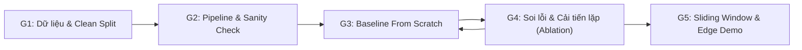

# SafePool: Lộ Trình Phát Triển Hệ Thống 5 Giai Đoạn (From Scratch)

> **Mã dự án:** SafePool — Edge AI Drowning Detection & Early Warning System  
> **Kiến trúc đã chốt:** 2-Stage Pipeline From Scratch (Stage 1: Person Localization 1-lớp $\rightarrow$ Stage 2: ROI Behavior Classification 3-lớp)  
> **Tài liệu tham chiếu:** [`bare_minimum.md`](bare_minimum.md) | [`dataset_specs.md`](dataset_specs.md)  
> **Nguồn dữ liệu cục bộ:** [`data/raw/`](../data/raw) ([`data.yaml`](../data/raw/data.yaml))  
> **Trạng thái:** Đã chốt hướng 2-Stage (Sẵn sàng triển khai Giai đoạn 1)

---

## Nguyên Tắc Vận Hành: Cố Định Cổng Kiểm Soát, Mở Giả Thuyết Thiết Kế

Để không làm mất tinh thần **tự thiết kế từ đầu (From Scratch)** trong [`bare_minimum.md`](bare_minimum.md), lộ trình này tách bạch hai phần:

- **Phần cố định (Process Gates & Target Criteria):** Hướng **2-Stage From Scratch** (không dùng pre-trained detector đóng gói sẵn cho Stage 1 hay backbone cho Stage 2), các cổng kiểm soát kỹ thuật (`Clean Split`, `Sanity Check`, `Baseline → Soi lỗi → Ablation`, `Model Freeze Tuần 6`) và ngưỡng tổng hệ thống (`Size < 15 MB`, `Params < 5.0M`, `FLOPs < 9.0 GFLOPs`, `≥ 30 FPS`, `Drowning Recall ≥ 90%`, `TTD < 4.0 giây`).
- **Phần mở (Design Space):** Các khối mạng cho cả Stage 1 và Stage 2 (`Residual`, `Depthwise Separable`, `FPN/BiFPN`, `CBAM`, `Coordinate Attention`, `LSKA`...), kích thước ROI (`128×128` hay `224×224`), hàm mất mát và augmentation **không đóng khung từ đầu** mà được lựa chọn dựa trên **phân tích lỗi thực tế của Baseline (`M1`)**.

---

## Tham Chiếu Dữ Liệu Thực Tế Của Dự Án

Theo [`data/raw/data.yaml`](../data/raw/data.yaml) và [`dataset_specs.md`](dataset_specs.md), bộ dữ liệu **Swimming and Drowning Detection (`v1`)** có thông số thực tế sau:

- **Định dạng & Độ phân giải gốc:** YOLOv8 (`.txt`), **12,365 ảnh** đồng nhất **$416 \times 416 \times 3$**, tổng **23,021 bounding boxes** (`1–22` người/ảnh, 100% có gán nhãn).
- **Cấu trúc phân chia thư mục thực tế (lưu ý `valid/`, không dùng `val/`):**

| Tập dữ liệu | Thư mục cục bộ | Số ảnh | Tỷ lệ | Tổng BBoxes | `0: Drowning` | `1: Person out of water` | `2: Swimming` |
| :--- | :--- | :---: | :---: | :---: | :---: | :---: | :---: |
| **Train** | `data/raw/train/` | **10,140** | 82.0% | **18,752** | 10,867 (57.95%) | 616 (3.28%) | 7,269 (38.76%) |
| **Validation** | `data/raw/valid/` | **1,478** | 12.0% | **2,748** | 1,577 (57.39%) | 98 (3.57%) | 1,073 (39.05%) |
| **Test** | `data/raw/test/` | **747** | 6.0% | **1,521** | 787 (51.74%) | 71 (4.67%) | 663 (43.59%) |
| **Tổng cộng** | `data/raw/` | **12,365** | 100.0% | **23,021** | **13,231** | **785** | **9,005** |

> [!IMPORTANT]
> **3 đặc thù dữ liệu thực tế cần kiểm soát ngay từ Giai đoạn 1:**
> 1. **Mất cân bằng lớp:** Lớp **`1: Person out of water`** là lớp thiểu số cực đoan (**3.28%** trên `train`), trong khi **`0: Drowning`** chiếm **57.95%** và **`2: Swimming`** chiếm **38.76%** (`Drowning` gấp ~`17.6×` lớp `1`).
> 2. **Rò rỉ dữ liệu giữa các tập (Cross-split Leakage):** Toàn bộ `12,365` ảnh chỉ xuất phát từ **`1,932` tiền tố ảnh nguồn**; có tới **91.1%** ảnh `valid/` (`1,347/1,478`) và **89.4%** ảnh `test/` (`668/747`) trùng tiền tố nguồn với `train/`. Cần có **clean Group Split** để đánh giá trung thực.
> 3. **Mục tiêu nhỏ & Tiền xử lý Roboflow:** Có **14.5%** box (`3,335/23,021`) nhỏ hơn `32×32 px` (`2.3%` có cạnh `< 16 px`), và ảnh gốc đã bị `Stretch` + `50% Vertical Flip`.

---

## GIAI ĐOẠN 1: Chuẩn Bị Dữ Liệu 2-Stage & Input Pipeline (Gate 1)

**Mục tiêu:** Đảm bảo dữ liệu đầu vào sạch, không rò rỉ giữa `train / valid / test`, và đóng gói đồng thời đầu vào cho **Stage 1 (Person Localization)** lẫn **Stage 2 (3-Class ROI Classification)**.

### Nội dung thực hiện
1. **Xác thực & lập chỉ mục chống rò rỉ (Clean Group Split):**
   - Kiểm tra toàn vẹn `12,365` cặp ảnh–nhãn trong `data/raw/{train,valid,test}` và `data.yaml`.
   - Gom nhóm theo tiền tố ảnh/video nguồn (phần trước `.rf.` và chuỗi video như `12_mp4-*`, `-Clipchamp-_mp4-*`) để tạo **clean Group Split** (không trùng ảnh/video nguồn giữa các tập), bên cạnh split mặc định của Roboflow để đối chiếu.
2. **Đóng gói dữ liệu cho Pipeline 2-Stage (trên cùng Clean Group Split):**
   - **Đầu vào Stage 1 (Person Localization — 1 lớp `person` trên `416 × 416`):**
     - Gộp cả 3 lớp (`0: Drowning`, `1: Person out of water`, `2: Swimming`) thành nhãn duy nhất `0: person` (`18,752` box ở tập `train` gốc). Nhờ gộp lớp, Stage 1 không bị mất cân bằng lớp và chỉ tập trung học định vị người + tách box gần nhau bằng **NMS / Soft-NMS**.
   - **Đầu vào Stage 2 (Behavior Classification — 3 lớp trên ROI crops):**
     - Cắt vùng bounding box từ `labels/*.txt` sang `data/processed/` với **padding ngữ cảnh `15–25%`** (giữ thông tin mặt nước/thành bể để phân biệt `Person out of water` và `Swimming`).
     - Đặt ngưỡng lọc box quá nhỏ (`min_box_size`, do `2.3%` box có cạnh `< 16 px` dễ vỡ/nhòe khi phóng lên `128×128`).
     - Giữ chuẩn 3 lớp: `0: Drowning`, `1: Person out of water`, `2: Swimming`.
3. **Chuẩn bị chiến lược xử lý mất cân bằng lớp cho Stage 2:**
   - Cung cấp công cụ tính phân bố lớp trên tập ROI sau lọc và **trọng số làm mịn** ($\sqrt{N_{\max}/N_c}$ hoặc *Effective Number of Samples*) để sẵn sàng thử nghiệm ở Giai đoạn 3–4 (tránh dùng $1/N_c$ thô vì chênh lệch `17.6×`).

### Điều kiện qua Gate 1 & Sản phẩm gợi ý
- Có manifest **clean Group Split** không rò rỉ, tập ROI `data/processed/` và `src/dataset.py` phục vụ cả Stage 1 (ảnh + `person` boxes) và Stage 2 (ROI + 3 nhãn `0, 1, 2`).
- Sản phẩm gợi ý: `scripts/prepare_roi_dataset.py` (kèm tạo split sạch) và `src/dataset.py`.

---

## GIAI ĐOẠN 2: Luồng Huấn Luyện & Sanity Check (Gate 2)

> **Lưu ý thuật ngữ:** *Giai đoạn 2 (Tuần 3)* trong lộ trình chịu trách nhiệm thiết lập vòng lặp huấn luyện và kiểm thử cho **cả hai khối mô hình**: **Stage 1 (Định vị người)** và **Stage 2 (Phân loại hành vi ROI)**.

- **Vai trò & Mục đích:** Đóng vai trò là **chốt chặn kỹ thuật (circuit breaker)** giúp *fail-fast* — cô lập hoàn toàn các lỗi kỹ thuật phần mềm (sai shape tensor, ngược kênh màu RGB/BGR, lệch nhãn `0, 1, 2`, trôi gradient, tràn RAM/VRAM) khỏi bài toán tối ưu AI trước khi tốn tài nguyên train lớn; đồng thời chuẩn hóa bộ thước đo an toàn sinh mạng (`Drowning` Recall, FAR, `mAP@50`) làm thước đo thống nhất xuyên suốt dự án.
- **Mục tiêu cốt lõi:**
  1. **Đóng gói vòng lặp Train/Eval cơ sở (`src/engine/trainer.py`, `src/metrics.py`):** Viết luồng forward, loss, backward, optimizer và tính metric chuẩn xác trên mọi phần cứng (`CPU/CUDA/MPS`), cố định seed tái lập.
  2. **Sanity Check (Overfit 1 batch nhỏ):** Huấn luyện thử nghiệm mồi trên 1 batch nhỏ (`8–16` ROI cho Stage 2; `1–4` ảnh cho Stage 1, tắt regularization/augmentation, `30–50` epochs) để chứng minh Loss tiệm cận `0` và đường ống tính toán hoàn toàn sạch bug trước khi bước vào Giai đoạn 3–4.
- **Sản phẩm gợi ý:** `src/engine/trainer.py`, `src/metrics.py`, cờ `--sanity-check` trong script train và log kiểm chứng mốc số 0 (`S2-00`, `S1-00`) trong `Specs/experiment_log.md`.

---

## GIAI ĐOẠN 3 & 4: Vòng Lặp Thiết Kế From Scratch, Soi Lỗi & Ablation Study (Iterative Gates 3–4)

> Thay vì chốt cứng một chuỗi `M1 → ResBlock → CBAM` hay tách rời cứng nhắc việc sửa kiến trúc với sửa Loss/Augmentation, Giai đoạn 3 và 4 vận hành theo **vòng lặp thực nghiệm có kiểm soát** (mỗi lượt chạy mục tiêu `30 phút – 2–3 giờ` để lặp nhanh).

### Ràng buộc kỹ thuật cần hướng tới (từ [`bare_minimum.md`](bare_minimum.md))
- **Ngân sách tổng cộng cả 2 Stage:** `Size < 15 MB` | `Params < 5.0M` | `FLOPs(Stage 1) + N × FLOPs(Stage 2) < 9.0 GFLOPs` (với $N \le 22$ người/ảnh) | **Inference tổng hợp:** $\ge 30\text{ FPS}$ (`< 33 ms/frame`) | **`Drowning` Recall:** $\ge 90\%$.
- *Gợi ý phân bổ ngân sách:* Giữ **Stage 2** thật gọn nhẹ (`< 1–2M` params, `< 0.1–0.2 GFLOPs/ROI`, chạy batch trên GPU/ONNX) để chừa phần lớn ngân sách cho **Stage 1** (`416×416`) và đảm bảo tổng tải luôn dưới trần khi bể đông người.

### Quy trình lặp mở (Hypothesis-Driven Loop)
1. **Dựng Mạng Mốc Tối Giản (`M1` — Simple Baseline cho Stage 2 & Stage 1):**
   - Bắt đầu với kiến trúc nhẹ, dễ kiểm soát nhất (ví dụ CNN phẳng nhẹ cho Stage 2 và bộ định vị 1-lớp tối giản cho Stage 1), dùng Loss cơ sở để làm chuẩn đối chiếu.
   - Đo đầy đủ Params, FLOPs, Model Size và hiệu năng trên **clean Group Split** (`valid`).
2. **Phân Tích Lỗi (`Error Analysis`) để chọn hướng cải tiến tiếp theo:**
   - Quan sát cụ thể `M1` đang hỏng ở đâu trước khi quyết định viết `M2`, `M3`:
     - *Nếu Stage 1 bỏ sót người nhỏ (`14.5%` box `< 32×32 px`) hoặc gộp nhầm người gần nhau:* Thử nghiệm kết hợp đặc trưng đa quy mô (FPN / BiFPN) hoặc tinh chỉnh **NMS / Soft-NMS**.
     - *Nếu Stage 2 nhầm lẫn do chói nắng, bọt nước, gợn sóng:* Thử nghiệm các khối chú ý (**CBAM**, **Coordinate Attention**, **LSKA**, hoặc khối tự thiết kế) và/hoặc augmentation mô phỏng môi trường nước (`ColorJitter`, *sun glare* bán trong suốt, *Motion/Gaussian Blur* nhẹ `kernel 3×3`).
     - *Nếu Stage 2 bỏ sót lớp `1: Person out of water` (`3.28%`) hoặc tụt `Drowning` Recall:* Thử nghiệm **Smoothed Class-weighted Loss**, **Focal Loss** ($\gamma = 2.0$), hoặc điều chỉnh kích thước ROI / tỷ lệ padding.
     - *Nếu tổng FLOPs / Params vượt trần hoặc tụt FPS:* Thay Conv chuẩn bằng **Depthwise Separable Conv**, thu hẹp channel hoặc tối ưu batch ROI.
   - **Lưu ý dữ liệu khi augment:** Không bật thêm `RandomVerticalFlip` vì `data/raw/` đã lật dọc 50% từ Roboflow.
3. **Thực nghiệm Loại trừ (Ablation Study) & Đánh giá End-to-End:**
   - Với mỗi thay đổi có chủ đích, chỉ thay đổi **một yếu tố chính tại một thời điểm**, giữ nguyên dữ liệu/seed để so sánh công bằng (`M1` vs `M2` vs `M3`...).
   - Chốt đánh giá cuối trên **tập `test/` của clean Group Split** cho cả **Stage 2 độc lập** (trên GT crops) lẫn **chuỗi End-to-End (`Stage 1 predicted boxes → Stage 2`)** (và ghi kèm kết quả trên split mặc định Roboflow để tham chiếu), kèm bảng tổng hợp: `Drowning Recall`, `Per-class Recall`, `Precision`, `Macro F1`, `FAR`, `Person mAP@50`, `Params`, `FLOPs`, `Size (MB)`.

### Tiêu chí Dừng Sớm & Time-Box Bảo Vệ Mốc Tuần 7 (Early-Stop & Model Freeze)
Để tránh bị cuốn vào vòng lặp thử nghiệm `M1 → M2 → M3...` làm trễ phần Realtime & Demo ở Tuần 7, áp dụng 3 quy tắc dừng sớm:

1. **Dừng sớm trong từng lượt train (Per-Run Early Stopping):**
   - Dùng `EarlyStopping(patience=8–12)` theo chỉ số chính trên `valid` (ưu tiên `Drowning Recall` + `Macro F1` / `mAP@50`, không dùng `Accuracy` tổng). Dừng ngay các thử nghiệm tụt hiệu năng rõ rệt sau `15–20` epochs đầu để giữ nhịp lặp nhanh.
2. **Dừng theo ngưỡng bão hòa (Diminishing Returns):**
   - Tối đa thử **3–5 giả thuyết cải tiến chính** sau `M1`. Nếu `2` vòng liên tiếp chỉ tăng `< +0.5%–1.0%` trên `valid` nhưng làm tăng FLOPs/độ trễ $\rightarrow$ dừng thêm độ phức tạp và chốt cấu hình gọn nhẹ nhất.
3. **Cổng thời gian cứng (Hard Model Freeze — Cuối Tuần 6):**
   - Chậm nhất **hết Tuần 6** phải đóng băng checkpoint tốt nhất đang thỏa mãn ngân sách Edge AI (`< 15 MB`, `< 5.0M` params, `< 9.0 GFLOPs`) và vượt qua `M1` trên `clean Group Split` để chuyển sang **Giai đoạn 5 đúng hạn Tuần 7**.
   - *Phương án dự phòng (Fallback) nếu chạm hạn Tuần 6 mà `Drowning Recall` đơn khung hình còn sát ngưỡng `90%`:* Không kéo dài việc sửa kiến trúc sang Tuần 7; điều chỉnh **ngưỡng quyết định (threshold tuning)** ưu tiên độ nhạy cho lớp `0: Drowning` và tận dụng **Sliding Window ở Giai đoạn 5** để lọc báo động giả theo chuỗi thời gian.

### Điều kiện qua Gate 3–4 & Sản phẩm gợi ý
- Chốt **Model Freeze** đúng mốc cuối Tuần 6 với ít nhất 1 phiên bản vượt Baseline (`M1`) trên dữ liệu sạch không rò rỉ, thỏa mãn ngân sách Edge AI, kèm **Nhật ký thực nghiệm** và **Bảng Ablation Study**.
- Các module mã nguồn tự thiết kế (ví dụ trong `models/` và `checkpoints/`).

---

## GIAI ĐOẠN 5: Bộ Lọc Thời Gian & Triển Khai Biên Thời Gian Thực (Gate 5)

**Mục tiêu:** Đưa mô hình tốt nhất vào chạy trên luồng video camera hồ bơi thực tế, đạt **$\ge 30\text{ FPS}$**, thời gian phản hồi **TTD $< 4.0\text{ giây}$** và loại bỏ báo động giả do sóng/chói tức thời.

### Nội dung thực hiện
1. **Ghép nối 2-Stage + Tracking & Bộ đệm Thời gian (Temporal Aggregation):**
   - Chạy `Stage 1 (Person Detector + NMS/Soft-NMS)` trên frame đầu vào $\rightarrow$ crop ROI có padding ngữ cảnh và suy luận theo batch qua `Stage 2`.
   - Dùng cơ chế theo dõi nhẹ giữa các khung hình liên tiếp (ví dụ **IoU / Centroid Tracker**) kết hợp **Frame Sampling** (`1–5 FPS`) và **Sliding Window** (`8–16` hoặc `16–30` frames) để lưu lịch sử xác suất `0: Drowning` riêng cho từng người bơi, bảo đảm **TTD $< 3.2\text{--}5.0\text{ giây}$**.
2. **Tối ưu hóa Mô hình Biên (Edge Export):**
   - Xuất cả hai mô hình Stage 1 và Stage 2 sang định dạng gọn nhẹ phù hợp thiết bị mục tiêu (**ONNX**, **TensorRT**, hoặc **FP16/INT8**), đo lại FPS & độ trễ tổng hợp thực tế ngoại tuyến.
3. **Ứng dụng Demo Thời gian thực:**
   - Xây dựng giao diện demo đọc RTSP/MP4 (OpenCV trực tiếp hoặc bọc qua Streamlit/Gradio tùy chọn theo [`bare_minimum.md`](bare_minimum.md)).
   - Hiển thị trực quan 3 lớp: `2: Swimming` (an toàn), `1: Person out of water` (trên bờ), `0: Drowning` (cảnh báo khi vượt ngưỡng chuỗi thời gian).

### Điều kiện qua Gate 5 & Sản phẩm gợi ý
- Ứng dụng demo chạy mượt ngoại tuyến đạt ngưỡng tốc độ biên + video minh họa thực tế.

---

## Timeline Gợi Ý 8 Tuần (Linh Hoạt Theo Vòng Lặp 2-Stage)

| Tuần | Giai đoạn | Trọng tâm (2-Stage From Scratch) | Tiêu chí hoàn thành (Gate) |
| :---: | :--- | :--- | :--- |
| **Tuần 1–2** | Giai đoạn 1 | Tạo **clean Group Split** chống rò rỉ từ `data/raw/`, sinh dữ liệu **Stage 1 (`person` 1-lớp)** và **Stage 2 (ROI crops có padding + lọc box nhỏ)**, viết `DataLoader` & kiểm tra cân bằng lớp. | Gate 1: Split sạch + DataLoader chuẩn cho cả 2 Stage |
| **Tuần 3** | Giai đoạn 2 | Viết vòng lặp train/eval + metrics an toàn sinh mạng, chạy **Sanity Check** overfit 1 batch cho Stage 2 & Stage 1. | Gate 2: Loss $\rightarrow 0$ trên 1 batch |
| **Tuần 4–6** | Giai đoạn 3 & 4 | Lặp nhanh có time-box: Dựng **Baseline `M1`** (Stage 2 + Stage 1) $\rightarrow$ **Soi lỗi** $\rightarrow$ thử giả thuyết (kiến trúc, attention/multi-scale, loss, augmentation) $\rightarrow$ **Ablation Study** + đánh giá End-to-End & dừng sớm. | Gate 3–4: **Model Freeze cuối Tuần 6** + Bảng Ablation đạt tổng budget Edge AI |
| **Tuần 7** | Giai đoạn 5 | Ghép **Stage 1 + Stage 2 + IoU Tracker + Sliding Window** (TTD `< 4s`), xuất **ONNX/FP16** đo $\ge 30\text{ FPS}$, làm demo RTSP/MP4. | Gate 5: Demo realtime đạt FPS & TTD |
| **Tuần 8** | Tổng kết | Tổng hợp nhật ký thực nghiệm, hoàn thiện Báo cáo đồ án và Slide bảo vệ. | Báo cáo hoàn chỉnh + Slide |

---

## Điểm Cần Xác Nhận Cuối Trước Khi Code Giai Đoạn 1

> Hướng **2-Stage From Scratch** đã được chốt. Chỉ cần bạn xác nhận thêm 1 điểm nền tảng bên dưới (và tùy chọn kích thước ROI khởi điểm, có thể chỉnh lại sau khi soi lỗi `M1`) để bắt đầu triển khai code Giai đoạn 1:

1. **Chuẩn đánh giá dữ liệu:** Dùng **clean Group Split** (tách theo `1,932` tiền tố ảnh/video nguồn để chống rò rỉ) làm bộ chuẩn chính, giữ split mặc định của Roboflow để tham chiếu, đúng chứ?
2. **Cấu hình ROI khởi điểm cho G1 (có thể điều chỉnh ở G3–G4):** Dự kiến crop ROI **`128×128`** (kèm padding ngữ cảnh `~20%`, lọc box training cạnh ngắn `< 16 px`), bạn đồng ý bắt đầu với mức này chứ?
