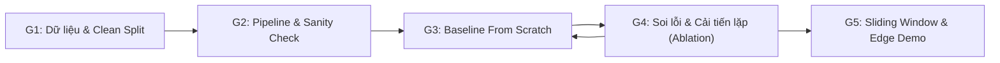

# SafePool: Lộ Trình Phát Triển Hệ Thống 5 Giai Đoạn (From Scratch)

> **Mã dự án:** SafePool — Edge AI Drowning Detection & Early Warning System  
> **Tài liệu tham chiếu:** [`bare_minimum.md`](bare_minimum.md) | [`dataset_specs.md`](dataset_specs.md)  
> **Nguồn dữ liệu cục bộ:** [`data/raw/`](../data/raw) ([`data.yaml`](../data/raw/data.yaml))  
> **Trạng thái:** Bản mở chờ duyệt (Flexible Draft for Review)

---

## Nguyên Tắc Vận Hành: Cố Định Cổng Kiểm Soát, Mở Giả Thuyết Thiết Kế

Để không làm mất tinh thần **tự thiết kế từ đầu (From Scratch)** trong [`bare_minimum.md`](bare_minimum.md), lộ trình này tách bạch hai phần:

- **Phần cố định (Process Gates & Target Criteria):** Các cổng kiểm soát kỹ thuật (sạch dữ liệu, sanity check, baseline $\rightarrow$ phân tích lỗi $\rightarrow$ ablation có nhật ký) và các ngưỡng mục tiêu Edge AI / an toàn sinh mạng (`Size < 15 MB`, `Params < 5.0M`, `FLOPs < 9.0 GFLOPs`, `≥ 30 FPS`, `Drowning Recall ≥ 90%`, `TTD < 4.0 giây`).
- **Phần mở (Design Space):** Hướng kiến trúc tổng thể (**1-Stage Detector** hay **2-Stage ROI**), các khối mạng (`Residual`, `Depthwise Separable`, `FPN/BiFPN`, `CBAM`, `Coordinate Attention`, `LSKA`...), hàm mất mát và augmentation **không đóng khung từ đầu** mà được lựa chọn dựa trên **phân tích lỗi thực tế của mô hình Baseline**.

---

## Tham Chiếu Dữ Liệu Thực Tế Của Dự Án

Theo [`data/raw/data.yaml`](../data/raw/data.yaml) và [`dataset_specs.md`](dataset_specs.md), bộ dữ liệu **Swimming and Drowning Detection (`v1`)** có thông số thực tế sau:

- **Định dạng & Độ phân giải gốc:** YOLOv8 (`.txt`), **12,365 ảnh** đồng nhất **$416 \times 416 \times 3$**, tổng **23,021 bounding boxes** (`1–22` người/ảnh, 100% có gán nhãn).
- **Cấu trúc phân chia thư mục thực tế (lưu ý `valid/`, không dùng `val/`):**

| Tập dữ liệu | Thư mục cục bộ | Số ảnh | Tỷ lệ | Tổng BBoxes | `0: Drowning` | `1: Person out of water` | `2: Swimming` |
| :--- | :--- | :---: | :---: | :---: | :---: | :---: | :---: |
| **Train** | `data/raw/train/` | **10,140** | 82.0% | **18,752** | 10,867 (57.95%) | 616 (3.28%) | 7,269 (38.76%) |
| **Validation** | `data/raw/valid/` | **1,478** | 12.0% | **2,748** | 1,577 (57.39%) | 98 (3.57%) | 1,073 (39.05%) |
| **Test** | `data/raw/test/` | **747** | 6.0% | **1,521** | 787 (51.74%) | 71 (4.67%) | 663 (43.59%) |
| **Tổng cộng** | `data/raw/` | **12,365** | 100.0% | **23,021** | **13,231** | **785** | **9,005** |

> [!IMPORTANT]
> **3 đặc thù dữ liệu thực tế cần kiểm soát ngay từ Giai đoạn 1:**
> 1. **Mất cân bằng lớp:** Lớp **`1: Person out of water`** là lớp thiểu số cực đoan (**3.28%** trên `train`), trong khi **`0: Drowning`** chiếm **57.95%** và **`2: Swimming`** chiếm **38.76%** (`Drowning` gấp ~`17.6×` lớp `1`).
> 2. **Rò rỉ dữ liệu giữa các tập (Cross-split Leakage):** Toàn bộ `12,365` ảnh chỉ xuất phát từ **`1,932` tiền tố ảnh nguồn**; có tới **91.1%** ảnh `valid/` (`1,347/1,478`) và **89.4%** ảnh `test/` (`668/747`) trùng tiền tố nguồn với `train/`. Cần có **clean Group Split** để đánh giá trung thực.
> 3. **Mục tiêu nhỏ & Tiền xử lý Roboflow:** Có **14.5%** box (`3,335/23,021`) nhỏ hơn `32×32 px` (`2.3%` có cạnh `< 16 px`), và ảnh gốc đã bị `Stretch` + `50% Vertical Flip`.

---

## GIAI ĐOẠN 1: Chuẩn Bị Dữ Liệu & Input Pipeline (Gate 1)

**Mục tiêu:** Đảm bảo dữ liệu đầu vào sạch, không rò rỉ giữa `train / valid / test` và đóng gói sẵn sàng theo hướng bài toán bạn chọn (**1-Stage** hoặc **2-Stage**).

### Nội dung thực hiện
1. **Xác thực & lập chỉ mục chống rò rỉ (Clean Group Split):**
   - Kiểm tra toàn vẹn `12,365` cặp ảnh–nhãn trong `data/raw/{train,valid,test}` và `data.yaml`.
   - Gom nhóm theo tiền tố ảnh/video nguồn (phần trước `.rf.` và chuỗi video như `12_mp4-*`, `-Clipchamp-_mp4-*`) để tạo **clean Group Split** (không trùng ảnh/video nguồn giữa các tập), bên cạnh split mặc định của Roboflow để đối chiếu.
2. **Đóng gói Input theo một trong hai hướng mở (chỉ chọn hướng phù hợp mục tiêu):**
   - **Hướng A — 1-Stage Object Detection trực tiếp (`416 × 416`):**
     - Đọc trực tiếp ảnh `416 × 416` và nhãn bounding box 3 lớp (`0: Drowning`, `1: Person out of water`, `2: Swimming`) từ `data/raw/` theo manifest sạch.
     - Ưu điểm: Khớp 100% định dạng YOLO của dữ liệu gốc, chạy một mô hình duy nhất cho cả ảnh đông `1–22` người, tuân thủ triệt để nguyên tắc *from scratch* mà không phải gánh 2 mô hình nối tiếp.
   - **Hướng B — 2-Stage Pipeline (Stage 1 Định vị người from scratch + Stage 2 Phân loại ROI):**
     - Chuẩn bị thêm tập ROI crops từ `labels/*.txt` (lọc `min_box_size` để tránh vỡ ảnh với các box cạnh `< 16 px`, mở rộng padding ngữ cảnh `15–25%` để giữ mặt nước/thành bể).
     - Lưu ý bắt buộc: Ở hướng này, **Stage 1 cũng phải tự xây dựng/huấn luyện from scratch** (không dùng detector pre-trained đóng gói sẵn) nếu muốn giữ đúng Nguyên tắc 1 của [`bare_minimum.md`](bare_minimum.md).
3. **Chuẩn bị chiến lược xử lý mất cân bằng lớp:**
   - Cung cấp công cụ tính phân bố lớp và **trọng số làm mịn** ($\sqrt{N_{\max}/N_c}$ hoặc *Effective Number of Samples*) để sẵn sàng thử nghiệm ở Giai đoạn 3–4 (tránh dùng $1/N_c$ thô vì chênh lệch `17.6×`).

### Điều kiện qua Gate 1 & Sản phẩm gợi ý
- Có manifest/split sạch không rò rỉ và `DataLoader` PyTorch đọc chuẩn 3 lớp (`0, 1, 2`).
- *Tùy hướng chọn:* `src/dataset.py` (và `scripts/prepare_roi_dataset.py` nếu đi Hướng B).

---

## GIAI ĐOẠN 2: Luồng Huấn Luyện & Sanity Check (Gate 2)

**Mục tiêu:** Đảm bảo đường ống toán học (forward, loss, backward, optimizer, metric) hoàn toàn không có bug trước khi bước vào vòng lặp thử nghiệm kiến trúc.

### Nội dung thực hiện
1. **Xây dựng Training & Evaluation Loop cơ sở:**
   - Viết vòng lặp train/eval tối giản, tính Loss và bộ chỉ số an toàn sinh mạng trong [`bare_minimum.md`](bare_minimum.md): **Per-class Recall** (trọng tâm **`Drowning` Recall** ở class `0` và theo dõi sát class `1: Person out of water`), **Precision**, **Macro F1-Score**, **False Alarm Rate (FAR)** (và **mAP@50 / IoU** nếu đi hướng Detection).
2. **Sanity Check (Overfit 1 Batch nhỏ):**
   - Rút trích `1` batch nhỏ (`8–16` mẫu có đủ 3 lớp `0, 1, 2`), tắt toàn bộ regularization/augmentation, train `30–50` epochs.
   - **Điều kiện qua Gate 2:** Loss giảm tiệm cận `0`, chỉ số trên chính batch đó đạt gần `100%`. Nếu không đạt, xử lý dứt điểm lỗi tensor shape, chuẩn hóa kênh màu hoặc nhãn trước khi sang Giai đoạn 3.

### Sản phẩm gợi ý
- `src/train.py` (hoặc module train/eval tối giản hỗ trợ chế độ `--sanity-check`).

---

## GIAI ĐOẠN 3 & 4: Vòng Lặp Thiết Kế From Scratch, Soi Lỗi & Ablation Study (Iterative Gates 3–4)

> Thay vì chốt cứng một chuỗi `M1 → ResBlock → CBAM` hay tách rời cứng nhắc việc sửa kiến trúc với sửa Loss/Augmentation, Giai đoạn 3 và 4 vận hành theo **vòng lặp thực nghiệm có kiểm soát** (mỗi lượt chạy mục tiêu `30 phút – 2–3 giờ` để lặp nhanh).

### Ràng buộc kỹ thuật cần hướng tới (từ [`bare_minimum.md`](bare_minimum.md))
- **Model Size:** `< 15 MB` | **Params:** `< 5.0M` | **FLOPs:** `< 9.0 GFLOPs` | **Inference:** $\ge 30\text{ FPS}$ (`< 33 ms/frame`) | **`Drowning` Recall:** $\ge 90\%$.
- *(Nếu đi Hướng B — 2-Stage, ngân sách FLOPs & FPS được tính trên tổng `Stage 1 + N × Stage 2` với $N \le 22$ người/khung hình.)*

### Quy trình lặp mở (Hypothesis-Driven Loop)
1. **Dựng Mạng Mốc Tối Giản (`M1` — Simple Baseline):**
   - Viết một mạng nhỏ, dễ kiểm soát nhất (ví dụ CNN phẳng nhẹ hoặc Tiny Detector tối giản) với `CrossEntropyLoss` chuẩn, chưa phức tạp hóa khối đặc biệt.
   - Đo đầy đủ Params, FLOPs, Model Size và hiệu năng trên **clean Group Split** (`valid`).
2. **Phân Tích Lỗi (`Error Analysis`) để chọn hướng cải tiến tiếp theo:**
   - Quan sát cụ thể `M1` đang hỏng ở đâu trước khi quyết định viết `M2`, `M3`:
     - *Nếu mất mục tiêu nhỏ (`14.5%` box `< 32×32 px`):* Thử nghiệm kết hợp đặc trưng đa quy mô (FPN / BiFPN / Skip-scale).
     - *Nếu nhiễu do chói nắng, bọt nước, gợn sóng:* Thử nghiệm các khối chú ý (**CBAM**, **Coordinate Attention**, **LSKA**, hoặc khối tự thiết kế) và/hoặc augmentation mô phỏng môi trường nước (`ColorJitter`, *sun glare* bán trong suốt, *Motion/Gaussian Blur* nhẹ `kernel 3×3`).
     - *Nếu bỏ sót lớp `1: Person out of water` (`3.28%`) hoặc tụt `Drowning` Recall:* Thử nghiệm **Smoothed Class-weighted Loss** hoặc **Focal Loss** ($\gamma = 2.0$).
     - *Nếu quá tải FLOPs / Params hoặc tụt FPS:* Thay Conv chuẩn bằng **Depthwise Separable Conv**, thu hẹp channel hoặc chỉnh **NMS / Soft-NMS**.
   - **Lưu ý dữ liệu khi augment:** Không bật thêm `RandomVerticalFlip` vì `data/raw/` đã lật dọc 50% từ Roboflow.
3. **Thực nghiệm Loại trừ (Ablation Study) & Ghi Nhật Ký:**
   - Với mỗi thay đổi có chủ đích, chỉ thay đổi **một yếu tố chính tại một thời điểm**, giữ nguyên dữ liệu/seed để so sánh công bằng (`M1` vs `M2` vs `M3`...).
   - Chốt đánh giá cuối trên **tập `test/` của clean Group Split** (và ghi kèm kết quả trên split mặc định Roboflow để tham chiếu), kèm bảng tổng hợp: `Drowning Recall`, `Per-class Recall`, `Precision`, `Macro F1`, `FAR` / `mAP@50`, `Params`, `FLOPs`, `Size (MB)`.

### Điều kiện qua Gate 3–4 & Sản phẩm gợi ý
- Có ít nhất 1 phiên bản cải tiến vượt qua Baseline (`M1`) trên dữ liệu sạch không rò rỉ, thỏa mãn ngân sách Edge AI, kèm **Nhật ký thực nghiệm** và **Bảng Ablation Study**.
- Các module mã nguồn tự thiết kế (ví dụ trong `models/` và `checkpoints/`).

---

## GIAI ĐOẠN 5: Bộ Lọc Thời Gian & Triển Khai Biên Thời Gian Thực (Gate 5)

**Mục tiêu:** Đưa mô hình tốt nhất vào chạy trên luồng video camera hồ bơi thực tế, đạt **$\ge 30\text{ FPS}$**, thời gian phản hồi **TTD $< 4.0\text{ giây}$** và loại bỏ báo động giả do sóng/chói tức thời.

### Nội dung thực hiện
1. **Tích hợp Bộ đệm Thời gian (Temporal Aggregation):**
   - Áp dụng **Frame Sampling** (`1–5 FPS`) kết hợp **Sliding Window** (`8–16` hoặc `16–30` frames) để làm mịn xác suất lớp `0: Drowning` theo chuỗi thời gian, bảo đảm **TTD $< 3.2\text{--}5.0\text{ giây}$**.
2. **Tối ưu hóa Mô hình Biên (Edge Export):**
   - Xuất trọng số PyTorch sang định dạng gọn nhẹ phù hợp thiết bị mục tiêu (**ONNX**, **TensorRT**, hoặc **FP16/INT8**), đo lại FPS & độ trễ thực tế ngoại tuyến.
3. **Ứng dụng Demo Thời gian thực:**
   - Xây dựng giao diện demo đọc RTSP/MP4 (OpenCV trực tiếp hoặc bọc qua Streamlit/Gradio tùy chọn theo [`bare_minimum.md`](bare_minimum.md)).
   - Hiển thị trực quan 3 lớp: `2: Swimming` (an toàn), `1: Person out of water` (trên bờ), `0: Drowning` (cảnh báo khi vượt ngưỡng chuỗi thời gian).

### Điều kiện qua Gate 5 & Sản phẩm gợi ý
- Ứng dụng demo chạy mượt ngoại tuyến đạt ngưỡng tốc độ biên + video minh họa thực tế.

---

## Timeline Gợi Ý 8 Tuần (Linh Hoạt Theo Vòng Lặp)

| Tuần | Giai đoạn | Trọng tâm (Không khóa cứng kiến trúc) | Tiêu chí hoàn thành (Gate) |
| :---: | :--- | :--- | :--- |
| **Tuần 1–2** | Giai đoạn 1 | Chốt hướng 1-Stage vs 2-Stage, tạo **clean Group Split** chống rò rỉ từ `data/raw/`, viết `DataLoader` và kiểm tra cân bằng lớp. | Gate 1: Split sạch + DataLoader chuẩn 3 lớp |
| **Tuần 3** | Giai đoạn 2 | Viết vòng lặp train/eval + metrics an toàn sinh mạng, chạy **Sanity Check** overfit 1 batch. | Gate 2: Loss $\rightarrow 0$ trên 1 batch |
| **Tuần 4–6** | Giai đoạn 3 & 4 | Lặp nhanh: Dựng **Baseline `M1`** $\rightarrow$ **Soi lỗi** $\rightarrow$ thử các giả thuyết (kiến trúc, attention/multi-scale, loss, augmentation nhiễu nước) $\rightarrow$ **Ablation Study**. | Gate 3–4: Bảng Ablation + Model đạt budget Edge AI |
| **Tuần 7** | Giai đoạn 5 | Ghép **Sliding Window** (TTD `< 4s`), xuất **ONNX/FP16** đo $\ge 30\text{ FPS}$, làm demo RTSP/MP4. | Gate 5: Demo realtime đạt FPS & TTD |
| **Tuần 8** | Tổng kết | Tổng hợp nhật ký thực nghiệm, hoàn thiện Báo cáo đồ án và Slide bảo vệ. | Báo cáo hoàn chỉnh + Slide |

---

## Hai Quyết Định Mở Cần Chốt Trước Khi Code Giai Đoạn 1

> Chỉ cần chốt **2 điểm nền tảng** bên dưới để bắt đầu code `G1–G2`; toàn bộ chi tiết về khối mạng (`ResBlock`, `CBAM`, `BiFPN`, `LSKA`...), hàm mất mát (`CE` vs `Focal`) và kích thước/siêu tham số sẽ để mở theo kết quả thử nghiệm của `M1`.

1. **Hướng tiếp cận chính (tuân thủ From Scratch):**
   - **Hướng A:** 1-Stage Tiny Detector tự thiết kế trực tiếp trên `$416 \times 416$`; **hay**
   - **Hướng B:** 2-Stage (Stage 1 tách người from scratch + Stage 2 phân loại ROI).
2. **Chuẩn đánh giá dữ liệu:**
   - Dùng **clean Group Split** (tách theo `1,932` tiền tố nguồn để chống rò rỉ) làm bộ chuẩn chính và chỉ giữ split mặc định của Roboflow để tham chiếu, đúng chứ?
