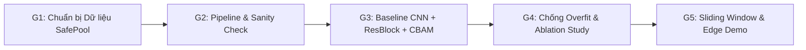

# SafePool: Lộ Trình Phát Triển Hệ Thống 5 Giai Đoạn (From Scratch)

> **Mã dự án:** SafePool — Edge AI Drowning Detection & Early Warning System  
> **Tài liệu tham chiếu:** [`bare_minimum.md`](bare_minimum.md) | [`dataset_specs.md`](dataset_specs.md)  
> **Nguồn dữ liệu cục bộ:** [`data/raw/`](../data/raw) ([`data.yaml`](../data/raw/data.yaml))  
> **Trạng thái:** Bản nháp chờ duyệt (Draft for Review)

---

## Tổng Quan Luồng Thực Hiện (5 Stages)

---

## Tham Chiếu Dữ Liệu Thực Tế Của Dự Án

Theo [`data/raw/data.yaml`](../data/raw/data.yaml) và báo cáo kiểm định tại [`dataset_specs.md`](dataset_specs.md), bộ dữ liệu **Swimming and Drowning Detection (`v1`)** có thông số cố định sau:

- **Định dạng & Độ phân giải gốc:** YOLOv8 (`.txt`), **12,365 ảnh** đồng nhất **$416 \times 416 \times 3$**, tổng **23,021 bounding boxes** (`1–22` người/ảnh, 100% có gán nhãn).
- **Cấu trúc phân chia thư mục thực tế (lưu ý `valid/`, không dùng `val/`):**

| Tập dữ liệu | Thư mục cục bộ | Số ảnh | Tỷ lệ | Tổng BBoxes | `0: Drowning` | `1: Person out of water` | `2: Swimming` |
| :--- | :--- | :---: | :---: | :---: | :---: | :---: | :---: |
| **Train** | `data/raw/train/` | **10,140** | 82.0% | **18,752** | 10,867 (57.95%) | 616 (3.28%) | 7,269 (38.76%) |
| **Validation** | `data/raw/valid/` | **1,478** | 12.0% | **2,748** | 1,577 (57.39%) | 98 (3.57%) | 1,073 (39.05%) |
| **Test** | `data/raw/test/` | **747** | 6.0% | **1,521** | 787 (51.74%) | 71 (4.67%) | 663 (43.59%) |
| **Tổng cộng** | `data/raw/` | **12,365** | 100.0% | **23,021** | **13,231** | **785** | **9,005** |

> [!IMPORTANT]
> **Lưu ý đặc thù dữ liệu thực tế cần xử lý ngay từ Giai đoạn 1:**
> 1. **Mất cân bằng lớp:** Lớp **`1: Person out of water`** là lớp thiểu số cực đoan (**3.28%** trên `train`), trong khi **`0: Drowning`** chiếm **57.95%** và **`2: Swimming`** chiếm **38.76%** (`Drowning` gấp ~`17.6×` lớp `1`).
> 2. **Rò rỉ dữ liệu giữa các tập (Cross-split Leakage):** Toàn bộ `12,365` ảnh chỉ xuất phát từ **`1,932` tiền tố ảnh nguồn**; có tới **91.1%** ảnh `valid/` (`1,347/1,478`) và **89.4%** ảnh `test/` (`668/747`) trùng tiền tố nguồn với `train/`. Cần tạo **Group Split sạch** để đánh giá trung thực.
> 3. **Mục tiêu nhỏ & Resize Stretch:** Có **14.5%** box (`3,335/23,021`) nhỏ hơn `32×32 px` (`2.3%` có cạnh `< 16 px`), và tập gốc đã bị `Stretch` + `50% Vertical Flip`.

---

## GIAI ĐOẠN 1: Chuẩn bị Dữ liệu & Đóng gói Input Pipeline

**Mục tiêu:** Chuẩn hóa bộ dữ liệu đa mục tiêu `data/raw/` (`416 × 416`) thành pipeline đầu vào gọn nhẹ cho thiết bị biên, đồng thời xử lý triệt để rò rỉ dữ liệu theo ảnh/video nguồn và nhiễu box quá nhỏ.

### Nội dung thực hiện
1. **Xác thực dữ liệu thô:**
   - Kiểm tra toàn vẹn `12,365` cặp ảnh–nhãn trong `data/raw/{train,valid,test}` và `data/raw/data.yaml` trước khi tiền xử lý.
2. **Xử lý chống rò rỉ dữ liệu (Group Split theo nguồn):**
   - Ngoài cấu trúc split gốc của Roboflow (`train/valid/test`), xây dựng bước nhóm theo tiền tố nguồn (prefix trước `.rf.` và tên video nguồn như `12_mp4-*`, `-Clipchamp-_mp4-*`) để xuất một **clean Group Split** (`train / valid / test` không trùng ảnh/video nguồn) phục vụ đánh giá tổng quát hóa trung thực.
3. **Định hình bài toán (Chốt 2-Stage ROI hoặc 1-Stage Detector):**
   - **Hướng 2-Stage Pipeline (theo khung xương hiện tại):**
     - *Trong huấn luyện Stage 2:* Cắt ROI từ `data/raw/{split}/labels/*.txt`, **lọc bỏ box quá nhỏ** (`min_box_size`, do `2.3%` box có cạnh `< 16 px` dễ gây mờ/vỡ), **thêm padding ngữ cảnh `15–25%`** (giữ thông tin mặt nước/thành bể để phân biệt `Person out of water` và `Swimming`), resize về **$128 \times 128 \times 3$** (hoặc **$224 \times 224 \times 3$**) lưu tại `data/processed/`.
     - *Trong suy luận thực tế (Giai đoạn 5):* Do khung hình thực tế có `1–22` người, cần Stage 1 (bộ định vị người tự huấn luyện *from scratch* theo [`bare_minimum.md`](bare_minimum.md)) + **NMS / Soft-NMS** để cấp ROI cho Stage 2.
   - **Stage 2 (Behavior Classification — 3 lớp chuẩn `data.yaml`):**
     - `0`: **`Drowning`** *(Đuối nước — lớp trọng tâm sống còn)*
     - `1`: **`Person out of water`** *(Người trên bờ / ngoài nước — lớp thiểu số cực đoan)*
     - `2`: **`Swimming`** *(Bơi bình thường)*
4. **Xử lý mất cân bằng lớp có kiểm soát:**
   - Tránh dùng nghịch đảo tần suất thô ($1/N_c$) vì chênh lệch `17.6×` dễ gây mất ổn định gradient hoặc tụt `Drowning` Recall. Chuẩn bị **trọng số làm mịn** ($\sqrt{N_{\max}/N_c}$ hoặc *Effective Number of Samples*) kết hợp **Focal Loss** ($\gamma = 2.0, \alpha$) để đối chứng với `CrossEntropyLoss` tiêu chuẩn.

### Sản phẩm đầu ra (Deliverable)
- `scripts/prepare_roi_dataset.py`: Script sinh tập ROI chuẩn hóa `data/processed/{train,valid,test}/` (hỗ trợ lọc `min_box_size`, padding ngữ cảnh và tùy chọn Group Split chống rò rỉ).
- `src/dataset.py`: PyTorch `Dataset` & `DataLoader` ánh xạ chuẩn 3 lớp `['Drowning', 'Person out of water', 'Swimming']` (`0, 1, 2`).

---

## GIAI ĐOẠN 2: Thiết lập Luồng Huấn luyện & Kiểm tra Cơ sở (Sanity Check Phase)

**Mục tiêu:** Kiểm soát rủi ro kỹ thuật, loại bỏ lỗi tensor shape mismatch, sai thứ tự kênh màu, sai ánh xạ nhãn `0/1/2` hoặc lỗi tính gradient trước khi chạy huấn luyện quy mô lớn trên `18,752` ROI của tập `train`.

### Nội dung thực hiện
1. **Xây dựng Training Loop cơ sở (`src/train.py`):**
   - Cài đặt `train_one_epoch()` và `evaluate()` chuẩn PyTorch.
   - Cài đặt các thước đo chuyên biệt theo [`bare_minimum.md`](bare_minimum.md): Loss, **Per-class Recall** (trọng tâm **`Drowning` Recall** ở class `0`, đồng thời theo dõi Recall lớp `1: Person out of water`), Precision, Macro F1-Score và **False Alarm Rate (FAR)**.
2. **Thực hiện Sanity Check (Overfitting trên 1 Batch):**
   - Trích xuất 1 batch nhỏ (`8–16` mẫu ROI) từ `data/processed/train/` có đủ cả 3 lớp (`0, 1, 2`).
   - Huấn luyện qua `30–50` epochs và **tắt toàn bộ regularization** (Dropout, Weight Decay, Data Augmentation).
   - **Điều kiện vượt qua:** Loss giảm tiệm cận `0`, Training Accuracy đạt xấp xỉ `100%`. Nếu không đạt, dừng lại sửa lỗi learning rate, hàm mất mát hoặc thứ tự nhãn trước khi qua Giai đoạn 3.

### Sản phẩm đầu ra (Deliverable)
- `src/train.py` chạy thông suốt ở cả chế độ `--sanity-check` và chế độ huấn luyện đầy đủ.

---

## GIAI ĐOẠN 3: Xây dựng Baseline & Cải tiến Kiến trúc Mạng (From Scratch)

**Mục tiêu:** Tự thiết kế kiến trúc mạng **From Scratch** (không sử dụng mô hình/trọng số pre-trained) thỏa mãn đồng thời khả năng lọc nhiễu quang học mặt nước và ngân sách Edge AI trong [`bare_minimum.md`](bare_minimum.md).

### Ràng buộc kỹ thuật bắt buộc
- **Model Size:** `< 15 MB` | **Params:** `< 5.0M` | **FLOPs:** `< 9.0 GFLOPs` | **Inference:** $\ge 30\text{ FPS}$ (`< 33 ms/frame`).
- Lưu ý: Nếu chạy 2-Stage trong thực tế, ngân sách FLOPs & FPS tính trên **tổng chi phí** `Stage 1 (trên 416×416) + N × Stage 2 (trên ROI)`, với $N$ có thể lên tới `22` người/khung hình.

### Nội dung thực hiện
1. **Mạng mốc tối giản (`M1` — Baseline CNN):**
   - Cấu trúc `3–4` khối `Conv2d (3x3) → BatchNorm2d → ReLU → MaxPool2d`.
   - Cuối mạng dùng **Global Average Pooling (GAP)** nối thẳng vào `Linear(..., 3)` (tương ứng 3 lớp `Drowning`, `Person out of water`, `Swimming`), loại bỏ lớp Dense phẳng gây phình tham số.
2. **Nâng cấp Khối Residual (`M2` — Baseline + ResBlock):**
   - Bổ sung Skip Connection ($F(x) + x$) để tăng độ sâu trích xuất đặc trưng hình thể người bơi (`Drowning` vs `Swimming`) mà không bị suy giảm gradient.
3. **Tích hợp Khối Chú ý (`M3` — Baseline + ResBlock + Attention):**
   - Tích hợp **CBAM** (Channel Attention + Spatial Attention) hoặc **Coordinate Attention** sau các tầng đặc trưng sâu.
   - Mục đích: Ép mạng tập trung vào hình dáng và tư thế cơ thể, triệt tiêu nhiễu chói nắng, bọt nước và gợn sóng ngoài trời.

### Sản phẩm đầu ra (Deliverable)
- `models/custom_drowning_net.py` chứa `CustomDrowningNet` hỗ trợ bật/tắt linh hoạt `use_resblock` và `use_attention`, kèm tiện ích thống kê Params / FLOPs / kích thước.

---

## GIAI ĐOẠN 4: Tinh chỉnh, Chống Quá khớp & Phân tích Loại trừ (Ablation Study)

**Mục tiêu:** Tối ưu khả năng tổng quát hóa trên `data/processed/valid/` (`2,748` ROI) và lập bảng thực nghiệm loại trừ minh bạch trên `data/processed/test/` (`1,521` ROI).

### Nội dung thực hiện
1. **Chiến lược chống Overfitting & bổ sung nhiễu nước đặc thù:**
   - **Data Augmentation:** Do `data/raw/` từ Roboflow đã có sẵn xoay `±15°`, phơi sáng `±15%` và lật dọc `50%`, **không bật thêm `RandomVerticalFlip`** trong PyTorch. Bổ sung `ColorJitter`, giả lập chói nắng (*sun glare* bán trong suốt cục bộ) và *Motion / Gaussian Blur* nhẹ (**giới hạn kernel `3×3`, `p ≈ 0.2–0.3`** để không làm mất chi tiết các ROI từ box nhỏ `< 32×32 px`).
   - **Regularization & Scheduler:** `Dropout (0.2–0.3)`, `Weight Decay (1e-4)` và `CosineAnnealingLR`.
   - **Hàm mất mát (Ablation Loss):** Dùng `CrossEntropyLoss` tiêu chuẩn làm mốc Baseline để đối chứng thực nghiệm với **Focal Loss** ($\gamma = 2.0$) và **Smoothed Class-weighted Loss**, theo dõi cân bằng giữa `Drowning` Recall và `Person out of water` Recall.
2. **Thực nghiệm Loại trừ (Ablation Study) trên cùng tập dữ liệu & siêu tham số:**
   - **`M1`**: Baseline CNN
   - **`M2`**: Baseline + ResBlock
   - **`M3`**: Baseline + ResBlock + CBAM / Coordinate Attention
3. **Đánh giá chốt trên tập `test/` độc lập (`747` ảnh Roboflow + `clean Group Split`):**
   - Ghi đầy đủ vào nhật ký thực nghiệm (báo cáo trên **cả split mặc định lẫn clean Group Split** chống rò rỉ): **`Drowning` Recall (mục tiêu $\ge 90\%$)**, **Per-class Recall** (`Drowning`, `Person out of water`, `Swimming`), **Precision**, **Macro F1-Score**, **FAR**, **Params (M)**, **FLOPs (GFLOPs)** và **Size (MB)**.

### Sản phẩm đầu ra (Deliverable)
- `checkpoints/best_drowning_model.pt` và **Bảng Ablation Study** chuẩn mực cho báo cáo.

---

## GIAI ĐOẠN 5: Tích hợp Bộ lọc Thời gian & Triển khai Biên Thời gian thực (Edge Deployment)

**Mục tiêu:** Đưa hệ thống SafePool vào chạy thực tế trên luồng video camera hồ bơi (RTSP / MP4), đạt tốc độ **$\ge 30\text{ FPS}$**, thời gian phản hồi **TTD $< 4.0\text{ giây}$** và loại bỏ báo động giả tức thời.

### Nội dung thực hiện
1. **Tích hợp Bộ đệm Thời gian (Temporal Sliding Window):**
   - Áp dụng **Frame Sampling** (`1–5 FPS`) kết hợp hàng đợi trượt **Sliding Window (`8–16` hoặc `16–30` frames)** lưu xác suất lớp `0: Drowning` theo từng đối tượng (ROI).
   - Chỉ kích hoạt cảnh báo nguy hiểm khi điểm rủi ro `Drowning` vượt ngưỡng liên tục trong cửa sổ thời gian quy định (đảm bảo **TTD $< 3.2\text{--}5.0\text{ giây}$**).
2. **Tối ưu hóa Mô hình Biên (Edge Optimization):**
   - Xuất mô hình `.pt` sang **ONNX** (`checkpoints/best_drowning_model.onnx`), tùy chọn lượng tử hóa **FP16 / INT8** để kiểm chứng tốc độ $\ge 30\text{ FPS}$ (`< 33 ms/frame`) trên Laptop/Edge PC ngoại tuyến.
3. **Xây dựng Ứng dụng Demo Thời gian thực (`app_demo.py`):**
   - Dùng OpenCV (có thể kèm giao diện Streamlit/Gradio theo [`bare_minimum.md`](bare_minimum.md)) đọc luồng video RTSP hoặc MP4 test.
   - Hiển thị trực quan phân biệt 3 lớp thực tế của SafePool:
     - `2: Swimming` $\rightarrow$ Bounding Box **xanh lá** (An toàn)
     - `1: Person out of water` $\rightarrow$ Bounding Box **xanh dương / xám** (Trên bờ)
     - `0: Drowning` $\rightarrow$ Bounding Box **đỏ nhấp nháy** + cảnh báo tại chỗ (âm thanh/banner) khi vượt ngưỡng chuỗi thời gian.

### Sản phẩm đầu ra (Deliverable)
- `app_demo.py`, file mô hình `.onnx` và video demo chạy thực tế.

---

## Bảng Tiến Độ Thực Hiện Đồ Án (Timeline 8 Tuần)

| Tuần | Giai đoạn | Công việc trọng tâm | Sản phẩm nghiệm thu |
| :---: | :--- | :--- | :--- |
| **Tuần 1–2** | Giai đoạn 1 | Xác thực `data/raw/`, tạo Group Split chống rò rỉ, viết script crop ROI (lọc `min_box_size`, padding ngữ cảnh) cho 3 lớp `Drowning`, `Person out of water`, `Swimming`, viết DataLoader & Smoothed Class Weights. | `scripts/prepare_roi_dataset.py`, `src/dataset.py`, `data/processed/` |
| **Tuần 3** | Giai đoạn 2 | Viết `train_one_epoch()` / `evaluate()` tính `Drowning` Recall & Per-class metrics, chạy Sanity Check overfit 1 batch. | `src/train.py` chạy thông suốt |
| **Tuần 4–5** | Giai đoạn 3 | Thiết kế From Scratch: Baseline CNN (`M1`), ResBlock (`M2`), Attention CBAM (`M3`) trong budget `< 15 MB` / `< 5M` params. | `models/custom_drowning_net.py` |
| **Tuần 6** | Giai đoạn 4 | Augmentation nhiễu nước + Focal Loss / Class Weights, huấn luyện và lập Bảng Ablation Study (`M1` vs `M2` vs `M3`) trên `valid/` và `test/`. | `checkpoints/best_drowning_model.pt` + Bảng Ablation Study |
| **Tuần 7** | Giai đoạn 5 | Tích hợp Sliding Window (TTD `< 4s`), xuất ONNX/FP16 kiểm tra $\ge 30\text{ FPS}$, hoàn thiện `app_demo.py` cho 3 lớp. | `app_demo.py` + `.onnx` + video demo |
| **Tuần 8** | Tổng kết | Tổng hợp nhật ký thực nghiệm, hoàn thiện Báo cáo đồ án và Slide bảo vệ. | Báo cáo hoàn chỉnh + Slide thuyết trình |

---

## Các Điểm Cần Chốt Trước Khi Bắt Đầu Giai Đoạn 1

1. **Kiến trúc tổng thể (2-Stage ROI vs 1-Stage Detector):** Chọn **2-Stage** (Stage 1 tách người from scratch + Stage 2 Custom CNN phân loại ROI `128×128` / `224×224`) hay **1-Stage Tiny Detector** trực tiếp trên ảnh `416×416`?
2. **Chiến lược chia dữ liệu (Chống Data Leakage):** Xuất thêm **clean Group Split** theo tiền tố nguồn (`1,932` nguồn độc lập) để đánh giá trung thực song song với split mặc định của Roboflow?
3. **Ngưỡng lọc & Padding ROI (nếu đi 2-Stage):** Ngưỡng `min_box_size` (ví dụ loại box cạnh `< 16 px`) và tỷ lệ padding ngữ cảnh (`15–25%`), cùng kích thước ROI (`128×128` hay `224×224`)?
4. **Hàm mất mát đối chứng:** Dùng `CrossEntropyLoss` (Baseline) đối chứng với **Smoothed Class-weighted Loss** / **Focal Loss** ($\gamma = 2.0$)?

